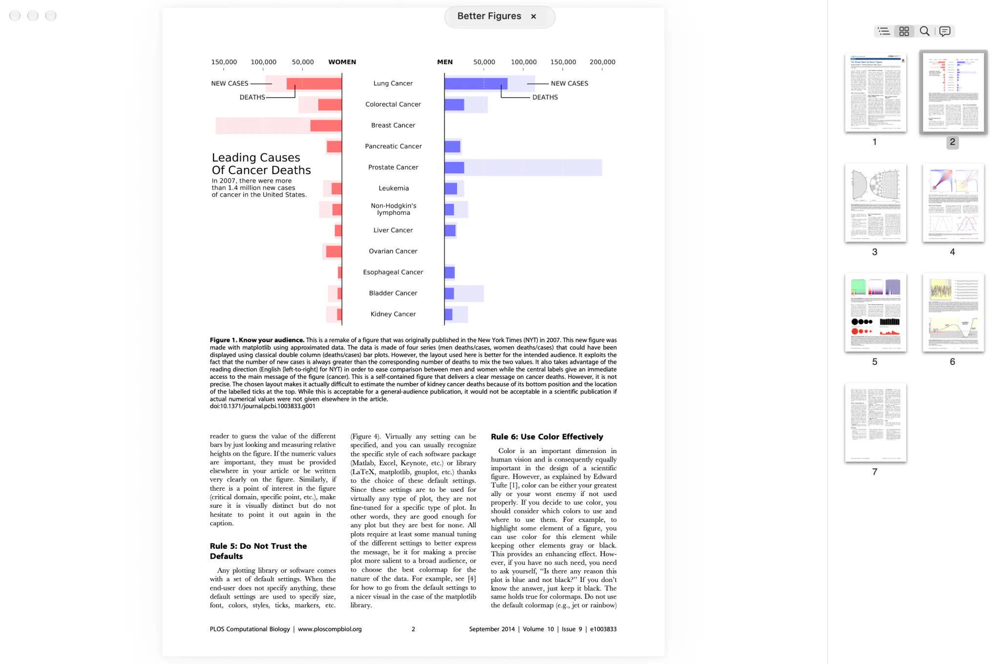

# Serein

<p align="center">
  
</p>

A minimal PDF reader for macOS, built with Swift, AppKit, and PDFKit.

[Website](https://serein.yfff.me) · [Download](https://github.com/Yalyenea/serein-pdf/releases/latest) · [Changelog](CHANGELOG.md)



## Download

Download the latest DMG from [Releases](https://github.com/Yalyenea/serein-pdf/releases/latest), open it, and drag Serein into Applications.

Requires an Apple silicon Mac running macOS 14 or later. Selection translation requires macOS 15 or later.

## Features

- **Tabs and spaces.** Organize PDFs into named spaces with vertical or titlebar tabs, custom icons, and inline naming.
- **Split reading.** Compare documents in nested splits, with independent navigation and zoom in each pane.
- **Reading modes.** Single-page, two-page, and book layouts, continuous scrolling, and an all-pages overview.
- **Navigation.** Search the current PDF or open documents, browse outlines, and move through reading history.
- **Annotations.** Highlight, underline, strike through, and add comments. Export annotations as Markdown, plain text, or JSON.
- **Link previews.** Preview internal references in a resizable window, pin them, or open them in a split.
- **Reading tools.** Fit to text width, lock horizontal panning, and follow the cursor with a reading focus band.
- **Themes.** Light and dark presets with custom page and window colors.
- **Translation.** Translate Chinese and English selections, look up words, and save translations as comments.
- **PDF library.** Browse local folders and reopen recent documents.
- **Live reload.** Read PDFs alongside LaTeX or Typst and see updates as you compile.
- **Presentation.** Present full screen with a pen and laser pointer.
- **Keyboard controls.** A command palette, Vim-style navigation, and customizable shortcuts.

## Shortcuts

| Action | Shortcut |
|---|---|
| Command palette | `⌘K` |
| Open PDFs | `⌘O` |
| Find in current PDF / open PDFs | `⌘F` / `⇧⌘F` |
| Highlight / underline / strikethrough | `A` / `U` / `S` |
| Add or edit comment | `M` |
| Translate selection | `T` |
| Toggle outline | `O` |
| Split right / below | `B` / `⇧B` |
| Focus pane left / down / up / right | `⌃H` / `⌃J` / `⌃K` / `⌃L` |
| Expand focused pane / restore layout | `⌘T` |
| Switch document | `⌃Tab` |
| Temporarily toggle light / dark | `I` |
| Save annotations | `⌘S` |

The Command Palette and Settings → Shortcuts list the available commands.

## Development

Requires Swift 6.1 or later, the macOS SDK, and [just](https://github.com/casey/just).

```sh
git clone https://github.com/Yalyenea/serein-pdf.git
cd serein-pdf
just run
```

```sh
just test    # Run tests
just build   # Build build/Serein.app
just dmg     # Package a DMG
```

`just test` runs XCTest and Swift Testing separately and checks both final summaries. Swift Testing uses a dedicated main-thread host so AppKit event loops cannot end the run early.

See [PROJECT.md](PROJECT.md) for architecture and behavior, [TASKS.md](TASKS.md) for planned work, and [REVIEW.md](REVIEW.md) for engineering debt.

## License

[GPL-3.0-only](LICENSE). Copyright © 2026 Yalyenea.
