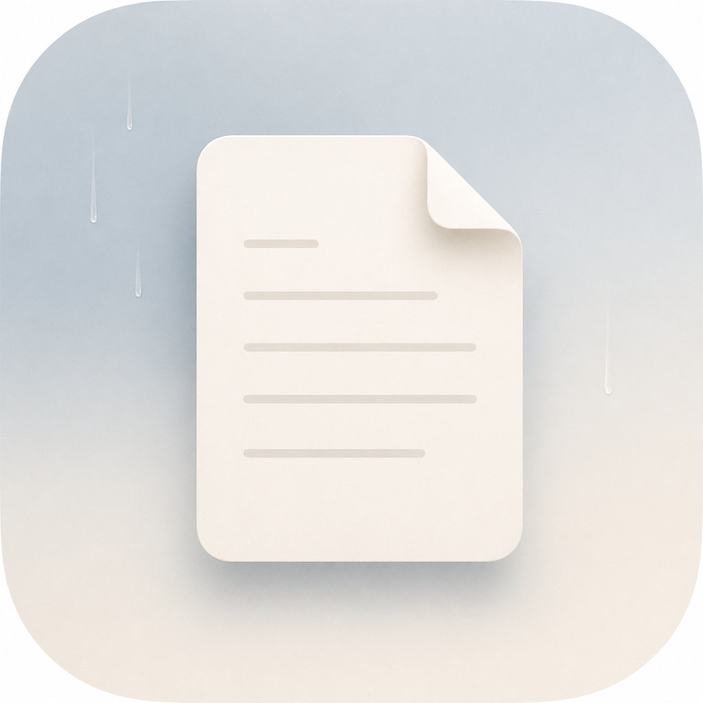

# Serein

<p align="center">
  
</p>

Native macOS PDF reader — Swift + AppKit + PDFKit. Minimal, flat, compact.

[Website](http://serein.yfff.me) · [Download](https://github.com/Yalyenea/serein-pdf/releases/latest) · [Docs](http://serein.yfff.me/#docs)

The release DMG supports Apple silicon Macs running macOS 14 or later.

## Features

- Tabbed documents with switchable layouts: left vertical sidebar or adaptive titlebar tabs, with the full PDF filename available on hover
- Named workspaces within each window. Vertical tabs use a bottom icon strip: click to switch, right-click an icon to rename, and use `+` to create. Horizontal tabs use an icon-only workspace menu. Move PDFs between workspaces from either tab context menu; each workspace retains its documents and reading layouts, including after its window closes.
- Switch adjacent workspaces with `cmd+option+←/→` or swipe horizontally over the workspace controls; navigation wraps at either end. Use `cmd+option+1…9` to select a workspace by its saved order within the window.
- Click a starting point, then Shift-click an endpoint to select text, including across pages and from line-boundary whitespace. Further Shift-clicks adjust the endpoint; an ordinary click starts a new selection.
- `cmd+o` supports selecting PDF files and folders; selected folders are scanned for PDFs automatically
- `cmd+option+t` creates an untitled blank tab; blank tabs are not PDF-backed, recent history entries, or relaunch-restored sessions
- Right pane hosts **Outline + Pages + Search + Annotations**; Annotations is a full-height compact comment feed with inline editing and keyboard navigation, while Outline adds heading filtering, wrapped titles, no horizontal panning, and one-click tree expand/collapse
- When the Outline pane is not active (right sidebar closed, or open on Pages / Search / Annotations), a Notion-style rail of heading marks appears at the reader's right edge; hover expands the full outline as a translucent, theme-tinted overlay sized to its content, long outlines scroll independently of the PDF within the configured maximum height, dragging either vertical edge adjusts that limit symmetrically around its center, and PDFs without an outline show no rail
- Both outlines follow the chapter at the focused reader's top edge, including headings on the same page. They expand ancestors and keep the current heading visible, pausing while you browse or filter. Press `o` to close the right sidebar and toggle the floating outline with keyboard focus on its headings; use arrows to choose a heading, then `enter` to jump or `esc` to cancel. Click the search field to filter.
- Right sidebar modes keep a consistent pane footprint, so switching Outline / Pages / Search / Annotations does not visually widen or narrow the sidebar
- Find bar supports `This Document` / `All Open`, match-case `Aa`, and whole-word `Word`; opening it with selected PDF text searches that text immediately, `All Open` scopes to PDFs in the active workspace, typing alone does not search, first `enter` submits, repeated `enter` / `cmd+g` / `cmd+shift+g` continue match navigation
- Reader navigation keeps the compact Vim-style layer: `c` toggles continuity within the current Single Page, Two-Up, or Book layout, `j` / `k` and `↓` / `↑` turn pages in vertical modes, `h` / `l` and `←` / `→` turn Book spreads, `ctrl+d` / `ctrl+u` scroll half a page, and `g` / `shift+g` jump to the document edges. Page-turn keys turn directly even when zoomed in. `cmd+[` / `cmd+]` restore exact pane-local positions across same-page and cross-document jumps.
- Cursor reading focus (`f`) dims the page outside a compact rounded band without blocking PDF interaction; `option+f` adjusts the current window between Page, Column (half-page), and Custom widths plus a configurable height
- Horizontal pan lock (`l`) preserves the current X position and blocks left/right panning and magnification gestures. Zoom commands and page/text fitting remain available and lock the resulting X position; vertical scroll and page turns stay free.
- Fit Text Width (`cmd+option+0`) zooms the main reader to the current page or spread's text bounds with 12pt side margins, preserving vertical reading position. The fit mode persists and adapts when the reading area or current page changes; pages without text retain their saved scale. `cmd+0` fits the page width.
- Split the focused reader right with `b` or below with `shift+b`. Repeat to build nested layouts, including four panes; new splits stop when the available area is too small. Each pane scrolls and zooms independently, while views of the same PDF share annotations and undo.
- `ctrl+h/j/k/l` moves focus left/down/up/right; `cmd+t` temporarily fills the reading area with the focused pane and restores the saved layout on a second press. Drag dividers to adjust local proportions. `cmd+ctrl+\` also remains available to open an empty comparison pane or collapse the active split group.
- Ordinary tab switching leaves a split group intact and restores it when you return to a member. Option-clicking a tab, splitting a link, or opening from a recent list always adds a pane without replacing an existing reader.
- New windows (`cmd+shift+n`) start empty. Workspace switches and relaunch restore the saved split trees, proportions, focus, and independent reading positions. Closed window groups remain available in the recent-windows list.
- Opening a PDF reuses its tab in the active workspace. The same file can also belong to other workspaces or windows, with independent reading positions and shared PDF annotations.
- Window commands can merge every Serein window, move the current PDF into a new or existing window, and vertical/titlebar tabs can be dragged directly between windows
- Main windows participate in native macOS green-button window management: Full Screen, Move & Resize, Fill, Center, and Fill & Arrange on supported macOS versions
- `ctrl+tab` opens a compact MRU list across every workspace in the current window. Hold Control and press Tab or Shift+Tab to cycle, use arrows to choose, and release Control to open the selection in its owning workspace. Esc cancels; the list order stays fixed during the gesture.
- Continuous reading groups from the tab context menu let selected PDFs read as one ordered flow; page turns cross PDF boundaries and the right Outline groups every PDF together
- `cmd+w` closes only the focused pane while split; in a single pane, it closes selected tabs or the current tab/window
- `cmd+shift+w` closes the current window while preserving the normal close confirmation for unsaved annotations
- Opening many PDFs stays lazy: tabs are created from URL/title first, while PDFKit documents, outlines, annotation caches, and search caches load only when a reader or sidebar actually needs them
- Clean PDFs hot-reload when LaTeX, Typst, or another external compiler rewrites the open file in place or replaces it atomically, preserving the live page; PDFs with unsaved Serein annotations are left untouched
- On first launch, Serein asks for persistent access to `/Users` so PDFs under user folders stay readable after reinstalling
- PDF Library folders can be configured in Settings; `cmd+k`, then `cmd+o` opens a two-pane library browser with an All tab, per-library tabs, folder scopes, indexed search, and direct PDF opening
- Compact Command Palette (`cmd+k`) lists current-context actions in a two-column grid, runs the highlighted command with `enter` or a click, and keeps the existing `cmd+k` two-stage shortcuts available inside the visible panel
- Compact recent-files launcher (`cmd+shift+space`) hides traffic lights, supports title/path filtering, `space` multi-select, `enter` open, and `esc` close even after the reader takes key focus
- The recent-windows list (`w`) defaults to the most recent other window and lists closed windows by closing order. It can activate an open window or restore a closed one. In the recent-files, recent-windows, and open-tabs lists, `option+enter` adds a pane on the right and `option+shift+enter` adds one below; these bindings are configurable. New splits inherit the source document's current reading pane, including its position and zoom. Splitting a PDF from another window preserves its source view. Recent-file splits require a single selection.
- Recent history keeps up to 200 entries and automatically prunes missing file links every 24 hours
- Opened PDFs are also noted to macOS native recent documents, and the active PDF URL is exposed to the window for system window/document integration
- Optional recent PDFs footer in the left sidebar (toggle in Settings) for one-click reopen
- Empty workspaces auto-collapse the outline pane; opening the first document restores it unless you explicitly toggled it while empty. The tabs pane keeps the workspace selector and moves Recent PDFs up as the quick-reopen entry; the right sidebar shows a single centered "No Document Open" state.
- Blank space in the document sidebar drags the current window while tabs, close buttons, scrolling, and the divider keep their own interactions
- Swap left and right sidebars on the fly (`cmd+shift+x`) or via Settings
- Settings General can edit the default left and right sidebar widths; the legacy opacity key remains config-only for compatibility
- Theme controls now split into `Mode`, `Light Theme`, and `Dark Theme`
- Choose from 17 light and 28 dark themes, including Rose Pine, Catppuccin, Everforest, GitHub, Gruvbox, Nord, Solarized, and Tokyo Night; each menu lists only supported variants
- Customize `Page` (PDF paper) and `Window` (reader surroundings and sidebars) colors beside each theme in Settings. Light and dark backgrounds save independently, survive theme changes, and reset to the selected theme with the adjacent reset button
- `i` toggles the current appearance mode between light and dark while keeping your selected light / dark themes
- `cmd+k`, then `cmd+t` switches the current light or dark theme, VS Code-style
- Copy the current page as an image (`cmd+option+c` or the reader context menu); the raster includes annotations at 2× mediaBox and does not apply night-mode filters
- `ctrl+cmd+c` sends the current context to Codex: selected text prefills a new task, otherwise the focused page is attached as a PNG. `ctrl+cmd+shift+c` attaches the current PDF. The integration can be disabled in Settings > General. Serein does not pass a workspace path, though Codex may choose the attached file's parent directory as its workspace.
- `Reveal in Finder` and `Open With` remain separate actions. `Open With` dynamically lists compatible installed apps such as Preview, Skim, or Adobe Acrobat in the File menu and PDF tab context menus.
- Browser integrations can hand off a downloaded local PDF through `serein://open?file=<encoded file URL>`; malformed links, directories, remote file hosts, and non-PDF files are rejected.
- Command Palette also exposes two-stage keys for refreshing the PDF Library index, opening Library / Shortcuts settings, sharing the current PDF, merging windows, and moving the current PDF to a new window
- Rose Pine Dawn replaces only the PDF's white paper with an Obsidian-like warm surface, preserving the document's original text and accent colors
- Rose Pine Moon maps the PDF's white/black endpoints to a dark paper/text pair, preserves warm/cool accent direction, and keeps the surrounding sidebars one shade deeper
- Pink-first highlight workflow (`a` to highlight) with a compact inline reader indicator
- Underline workflow (`u` to underline) shares the compact mode, comment, undo, save, sidebar, and export pipeline
- Strikethrough uses the same annotation pipeline with the plain `s` shortcut
- Select Chinese or English text and press `t` to translate into the other language. English words show a compact dictionary entry with pronunciation beside the speech button, including numbered headwords and inflected forms resolved by the system dictionary; long sentence translations scroll. Copy the result or add it as a new highlight with a translated comment attached to the original selection. A result is added only once and uses the normal undo and save workflow. Apple translation requires macOS 15 or later.
- Choose Automatic, English, or 中文 in Settings → General → Language. Automatic follows the system’s first preferred language (Chinese or English); changes apply after restarting Serein.
- Pink / yellow / green highlights use theme-specific sRGB palettes for Normal, Rose Pine Dawn, and Rose Pine Moon
- While highlight mode is active, plain `1` / `2` / `3` switch pink / yellow / green without intercepting text-field input
- `File > Share…` can share the original PDF, a clean copy, or highlights as Markdown text; `File > Export Clean Copy…` writes a PDF with user-visible annotations removed while preserving links and form widgets; `Export All Open Highlights…` groups the current window's annotated PDFs by document and page
- Highlights, underlines, and strikethroughs with comments preview on hover (delayed, suppressed when the same item is selected in the Annotations pane). Each multiline comment has one compact color dot that sits in nearby whitespace instead of covering following text; identical comments in older Serein groups are consolidated on open. Clicking the icon or preview edits in the same 6pt-corner card, preserving its width and attachment corner. A 150ms pointer grace period lets you move into the card; editing stays open when the pointer leaves. Double-clicking the annotation, `m`, and the context menu also open the editor. The card keeps short comments compact, grows for longer text, and shows `Save ⌘↩` at the bottom right. Esc cancels without a visible footer hint. The card follows the current theme. The Annotations list is a compact snippet + comment feed with a quiet selection; Markdown export remains page-grouped as snippet + comment
- Clicking an internal link opens a resizable preview that can be pinned. It starts with one copied page, loads adjacent pages while scrolling, and keeps at most three copies. Text geometry fits the target column or the page's text width with 12pt side margins; pages without text keep full-page width. Follow links inside the preview and use its independent Back/Forward history to restore page, viewport, and zoom. The source PDF and annotations remain unchanged. Option-click a reader link to split directly; Command-click jumps in the current reader. The preview's split button or `b` / `shift+b` opens its current position to the right / below, while Jump navigates the source reader.
- Settings includes a searchable, grouped Shortcuts page with capture, clear, reset-all, conflict rejection, and separate keycaps for built-in two-stage shortcuts
- Settings keeps one compact 680 pt width across General, Library, and Shortcuts; page height may adapt, while shortcut rows keep defaults and actions aligned without horizontal scrolling
- Find bar (`cmd+f` for current document, `cmd+shift+f` for all open PDFs) preloads selected PDF text when available; Esc clears search and exits
- All-pages overview (`cmd+shift+o`) seamless viewport-fit grid (no nested panel); zoom for manual size; click a page to jump
- Auto-update from GitHub Releases (check on launch + **Serein → Check for Updates…**); private repos need `[updates] github_token` in config.toml
- Single Page mode keeps fully visible pages centered on both axes and clamps blank-area scrolling, while zoomed-in pages can still pan normally
- In non-continuous Single Page and Two-Up modes, vertical trackpad gestures scroll within the page, then turn at the edge using the same navigation as J/K. Each gesture turns at most one page or spread; remaining motion is consumed, and momentum never initiates a turn.
- Book mode shows a centered cover followed by stable-size left/right page spreads. Fit Width uses the actual spread bounds, keeps compact safe margins, and fits both axes; manual zoom-out also stays centered whenever the spread fits the viewport. Horizontal wheel or trackpad movement turns one spread; Book · Continuous Turn allows deliberate continued movement to turn further spreads while momentum cannot skip ahead.
- Demo mode (`cmd+l`) enters full screen, fits the whole page with stable single-page framing, and hides reader chrome. Use `p` for a temporary pen, `r` for a laser pointer, and `v` for the normal pointer. The bottom toolbar can stay pinned or auto-hide; move to the bottom center to reveal it. `Esc` returns an active tool to the pointer, then exits demo mode; `cmd+l` exits directly and restores the prior layout.
- Presentation ink stays attached to its PDF page while navigating and remains separate in each window. `cmd+z` undoes the last stroke on the current page; `e` clears that page. Ink is never written to the PDF and is cleared when you leave demo mode or switch documents. The laser trail fades automatically.
- Immersive mode (`cmd+ctrl+l`) opens both sidebars only when none are visible; otherwise it hides both sidebars and tab chrome while keeping the current window size. Reopening only the outline keeps horizontal tabs hidden; showing the document sidebar or explicitly switching tab presentation restores tab chrome.
- Locked readers show a compact `L` in the upper-right corner; hover for the lock scope.
- Global Lock (`shift+l`) locks horizontal panning and magnification gestures across all windows and newly opened PDFs. It persists across restarts, preserves individual PDF lock states, and excludes Book modes. Turn it off to restore each PDF’s own lock; individual `l` toggles are disabled while Global Lock is on.
- Opening, closing, or resizing sidebars preserves the reading anchor. Fit modes follow the available reading area; manual zoom scales proportionally with its width to preserve the horizontal content range, including while Lock is enabled.
- Switching display modes after manual zoom fits the new page or spread width while preserving the live reading anchor.
- Trackpad pinch and keyboard zoom preserve the reading viewport's center. Pinch retains PDFKit's native scaling, and panning sets the center for subsequent gestures. Page-only outline destinations navigate to the target page's top.
- Sidebar and floating outlines share a compact search-and-collapse row, without a title or page-count footer.
- Each reading pane shows a physical page number or spread range and total. Click the counter to enter a page number; Enter jumps and Esc cancels in place. Settings can hide all page counters immediately.
- Each workspace and pane retains its own scale, page, and horizontal pan lock across launches. Window sidebars retain their widths separately from the reading splits.
- Switching PDFs briefly shows the current file name at the top of the reader, so fast tab changes stay oriented without adding permanent chrome
- Config-driven defaults via `~/Library/Application Support/Serein/config.toml`
- Continuous layouts preserve native trackpad momentum. Settings → General → Reading → Scroll Speed adjusts direct scrolling and momentum together from 0.5× to 3.0× (default 1.0×).

## Requirements

- macOS 14+; selection translation requires macOS 15+
- Swift 6.1 (Xcode 15.3+ toolchain)
- `just` task runner (`brew install just`)
- `duti` for setting the default PDF handler (`brew install duti`)

## Dev loop

```sh
just            # list targets
just test       # run Swift tests
just run        # run dev build via SwiftPM
just website    # preview the local static website
just website-check
```

## Ship to your Mac

```sh
just signing-identity # creates/reuses the local Serein signing identity
just build      # produces build/Serein.app (signed with the local identity)
just install    # copies the .app to /Applications
just register   # lsregister -f so Finder's Open With sees it
just dmg        # packages build/Serein-<version>.dmg
just launch     # open /Applications/Serein.app
```

`just build` signs with `Serein Local Code Signing` by default, creating that
self-signed code-signing identity in the login keychain on first use. Keeping a
stable signing identity prevents local reinstalls from changing the app identity
to a new cdhash-only ad-hoc signature. Set `SEREIN_CODESIGN_IDENTITY` to use a
different local or Developer ID identity.

Full release pipeline:

```sh
just test
just dmg
just ship       # build → install → register
```

## Configuration

Runtime config lives at `~/Library/Application Support/Serein/config.toml`
and is created on first launch. Edit, then restart Serein.

```toml
[appearance]
language = "automatic"         # automatic / en / zh; applies after restart
mode = "system"               # or "light" / "dark"
light_theme = "normal"        # e.g. "rose_pine_dawn", "catppuccin", "everforest"
dark_theme = "rose_pine_moon" # e.g. "normal", "nord", "tokyo-night"
light_page_background = ""   # empty = theme default; otherwise "#RRGGBB"
light_window_background = ""
dark_page_background = ""
dark_window_background = ""

[reader]
default_display_mode = "single_page_continuous"
fit_width_on_open = false
global_horizontal_pan_lock = false
show_page_counter = true
seamless_pages = false             # remove gaps between pages
scroll_speed = 1.0                 # continuous scrolling multiplier, 0.5–3.0
reading_focus_width = "page"       # or "column" / "custom"
reading_focus_custom_width = 0.72  # 0.3–1.0, used by "custom"
reading_focus_height = 96          # 48–240 pt

[annotations]
auto_save = "after_10_minutes"   # or "never"

[layout]
left_sidebar_width = 220
left_sidebar_min_width = 36
left_sidebar_max_width = 520
right_sidebar_width = 320
right_sidebar_min_width = 120
right_sidebar_max_width = 720
floating_outline_height = 360 # 180–720 pt; maximum expanded height
sidebars_swapped = false
show_recent_files_in_sidebar = true
sidebar_opacity = 0.48 # legacy compatibility; solid sidebars ignore this value

[library]
folders = ["/Users/your-name/Documents/Papers"]

[access]
roots = ["/Users"]
root_bookmarks = [] # managed by Serein; do not edit manually

[integrations]
codex_enabled = true

[shortcuts]
fit_text_width = "command+option+0"
highlight_selection = "a"
underline_selection = "u"
strikethrough_selection = "s"
switch_current_theme = "none"   # cmd+k, cmd+t is a built-in chord
open_library_pdf = "none"       # cmd+k, cmd+o is a built-in chord
refresh_library_index = "none"  # cmd+k, cmd+r is a built-in chord
open_library_settings = "none"  # cmd+k, cmd+l is a built-in chord
open_shortcut_settings = "none" # cmd+k, cmd+s is a built-in chord
share_document = "none"         # cmd+k, cmd+e is a built-in chord
export_clean_copy = "none"
add_comment = "m"
translate_selection = "t"
quick_outline = "o"
new_blank_tab = "command+option+t"
toggle_pane_zoom = "command+t"
split_current_pdf_right = "b"
split_current_pdf_down = "shift+b"
focus_pane_left = "control+h"
focus_pane_down = "control+j"
focus_pane_up = "control+k"
focus_pane_right = "control+l"
show_recent_windows = "w"
palette_split_right = "option+return"
palette_split_down = "option+shift+return"
copy_current_pdf_path = "command+shift+c"
copy_current_page_as_image = "command+option+c"
send_context_to_codex = "command+control+c"
send_current_pdf_to_codex = "command+control+shift+c"
toggle_continuous_reading = "none"
toggle_reading_focus = "f"
adjust_reading_focus = "option+f"
toggle_horizontal_pan_lock = "l"
toggle_global_horizontal_pan_lock = "shift+l"
book = "none"
book_continuous = "none"
toggle_display_mode_continuity = "c"
merge_all_windows = "none"      # cmd+k, cmd+m is a built-in chord
move_current_pdf_to_new_window = "none" # cmd+k, cmd+n is a built-in chord
# ...
```

- Layout widths seed new windows. Dragged sidebar widths belong to the window
  and restore with it; each reading split saves its own divider proportion.
- `mode = "system"` follows the current macOS appearance.
- `light_theme` and `dark_theme` are selected independently, so you can pair
  any available light preset with any dark preset. `cmd+k`, then `cmd+t`
  cycles the current appearance's presets.
- Background overrides accept opaque `#RRGGBB` colors; an empty string uses
  the selected theme's color. Invalid colors and unknown theme IDs are reported
  as configuration errors. Settings changes refresh open readers immediately.
  Background customization affects display only and does not recolor the PDF file.
- `sidebars_swapped = true` flips the left and right panes — window-level widths
  travel with the panes so your narrow tabs pane stays narrow after the swap.
- Empty windows and blank tabs show a large, faint serif italic `Serein` wordmark
  that scales with the reader area and follows the theme. It disappears when a
  PDF or loading error is displayed. The workspace selector stays available
  in an empty workspace, including in titlebar-tab mode.
- `fit_width_on_open` switches fit-to-width on/off for **all currently open
  documents** as soon as you toggle it — any document you've manually zoomed
  stays pinned at your scale.
- Reading focus defaults apply to every window until that window receives a
  temporary `option+f` adjustment. `page` follows the PDF page width, `column`
  selects the half-page under the pointer, and `custom` follows the pointer
  using `reading_focus_custom_width`.
- `library.folders` can contain one or more folders. The library browser scans
  them recursively, groups results by library root and PDF folder, keeps a
  lightweight in-session catalog cache, and invalidates it when the configured
  folders change.
- `access.roots` defaults to `/Users`. `access.root_bookmarks` stores the
  persistent macOS access token created on first launch, so reinstalling Serein
  does not require re-authorizing each PDF under user folders.
- Setting a shortcut to `none` clears its configurable direct binding; Serein
  will not restore that default after restart. Read-only built-in `cmd+k`
  sequences remain listed in Settings and the Command Palette. `cmd+k` itself
  is reserved for opening the palette.

## Keyboard shortcuts

Common shortcuts are listed below. Presentation tool keys apply only in demo mode.

| Action | Shortcut |
|---|---|
| Open / close Command Palette | `cmd+k` |
| Highlight selection / enter highlight mode | `a` |
| Underline selection / enter underline mode | `u` |
| Strikethrough selection / enter strikethrough mode | `s` |
| Add or edit comment | `m` |
| Translate selected text | `t` |
| Toggle outline | `o` |
| Exit annotation mode | `esc` |
| Temporarily toggle light / dark mode without changing settings | `i` |
| Switch current theme | `cmd+k`, then `cmd+t` |
| Refresh PDF Library index | `cmd+k`, then `cmd+r` |
| Open Library settings | `cmd+k`, then `cmd+l` |
| Open Shortcuts settings | `cmd+k`, then `cmd+s` |
| Save annotations | `cmd+s` |
| Print current PDF | `cmd+p` |
| Share current PDF | `cmd+k`, then `cmd+e` |
| Export clean copy | configurable, default none |
| Copy highlights as Markdown | `cmd+shift+e` |
| Copy current PDF path | `cmd+shift+c` |
| Copy current page as image | `cmd+option+c` |
| Send selected text, or current page image, to Codex | `ctrl+cmd+c` |
| Send current PDF to Codex | `ctrl+cmd+shift+c` |
| Open PDFs / folders (scan PDFs) | `cmd+o` |
| Open from PDF Library | `cmd+k`, then `cmd+o` |
| New blank tab | `cmd+option+t` |
| Fit width / height | `cmd+0` / `cmd+9` |
| Fit text width | `cmd+option+0` |
| Toggle cursor reading focus | `f` |
| Adjust current-window focus width / height | `option+f` |
| Toggle horizontal pan lock (preserve current X, block magnification gestures) | `l` |
| Toggle current layout continuity | `c` |
| Toggle seamless pages | `cmd+option+p` |
| Select document tabs 1–3 | physical left `cmd+1` / `cmd+2` / `cmd+3` |
| Single Page Continuous | physical right `cmd+2` |
| Other original display modes | physical right `cmd+1` / `cmd+3` / `cmd+4` |
| Book / Book · Continuous Turn | View menu; configurable, default none |
| Zoom in / out | `cmd+=` / `cmd+-` |
| Find current / all open PDFs | `cmd+f` / `cmd+shift+f` |
| Find next / previous match | `cmd+g` / `cmd+shift+g` |
| Highlight color in highlight mode | `1` / `2` / `3` (pink / yellow / green) |
| Reveal current PDF in Finder | `cmd+r` |
| Half-page down / up | `ctrl+d` / `ctrl+u` |
| Previous / next page in vertical modes | `k` / `j` or `↑` / `↓` |
| Previous / next Book spread | `h` / `l` or `←` / `→` |
| Jump to first / last page | `g` / `shift+g` |
| Close focused pane; in single-pane mode, close tabs | `cmd+w` |
| Close current window | `cmd+shift+w` |
| Reopen closed tab | `cmd+shift+t` |
| Cycle MRU tabs across workspaces | Hold `ctrl`, then `tab` / `shift+tab`; release to open |
| Previous / next workspace | `cmd+option+←` / `cmd+option+→` |
| Select workspaces 1–9 | `cmd+option+1…9` |
| Toggle continuous reading for selected tabs | Tab context menu |
| New window | `cmd+shift+n` |
| Merge all windows | `cmd+k`, then `cmd+m` |
| Move current PDF to new window | `cmd+k`, then `cmd+n` |
| Move current PDF to an existing window | Window menu, or drag its tab into that window |
| Quick recent-files launcher | `cmd+shift+space` |
| Recent windows | `w` |
| Split selected recent file / window / tab right or below | `option+enter` / `option+shift+enter` |
| Toggle sidebar tabs / titlebar tabs | `cmd+shift+1` / `cmd+shift+2` |
| Toggle left / right sidebar | `cmd+b` / `cmd+option+b` |
| Toggle demo mode | `cmd+l` |
| Demo: toggle pen / laser; select pointer | `p` / `r` / `v` |
| Demo: undo last stroke / clear current page | `cmd+z` / `e` |
| Demo: return to pointer, then exit | `esc` |
| Toggle immersive mode | `cmd+ctrl+l` |
| Toggle compare split | `cmd+ctrl+\` |
| Split focused reader right / below | `b` / `shift+b` |
| Focus reader left / down / up / right | `ctrl+h` / `ctrl+j` / `ctrl+k` / `ctrl+l` |
| Fill reading area with focused pane / restore layout | `cmd+t` |
| Split internal link directly / jump in current reader | `option+click` / `cmd+click` |
| Toggle right sidebar: Outline / Pages | `cmd+shift+l` |
| Swap left and right sidebars | `cmd+shift+x` |
| All-pages overview | `cmd+shift+o` |
| Undo last highlight edit | `cmd+z` |

Standard macOS app/window shortcuts are available too, including `cmd+h`,
`cmd+option+h`, `cmd+m`, and native macOS green-button tiling shortcuts.

## Docs (source of truth)

| File | Role |
|---|---|
| [PROJECT.md](PROJECT.md) | Product scope, architecture, shortcuts, models, open milestones |
| [TASKS.md](TASKS.md) | Live execution checklist (open items only) |
| [REVIEW.md](REVIEW.md) | Open engineering debt and roadmap |
| [CHANGELOG.md](CHANGELOG.md) | User-facing and engineering change log |
| [docs/theme-presets-plan.md](docs/theme-presets-plan.md) | Multi-theme presets plan (not started) |
| [docs/archive/](docs/archive/) | Completed milestone checklists and full 2026-06 review snapshot |

## Repo layout

```
App/         AppKit entry point, window + split + settings
Core/        Document session store, config, persistence
Features/    Annotation service, exporter, highlight colors, shortcut controller
UI/          CenterReader, LeftTabs, RightOutline, TitlebarTabs
Tests/       Swift Testing + XCTest suites
Resources/   Info.plist, AppIcon.png/.icns
Scripts/     make-app.sh, make-icon.sh
Website/     Static product website
Justfile     Task runner entrypoints
```

## License

Copyright © 2026 Yalyenea. Licensed under the GNU General Public License,
version 3 only (`GPL-3.0-only`). See [LICENSE](LICENSE).
